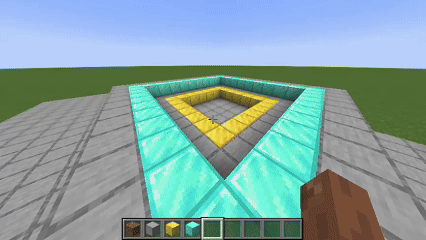

# Unfold Mod (主体展开 模组)

**Unfold Mod** 是一款为 Minecraft 引入全新空间解谜维度的 Fabric 模组。它深受《纪念碑谷》和《FEZ》等经典益智游戏的启发，允许你将三维的 Minecraft 世界“展开”成一个二维的正交视图。

在这个特殊的“展开模式”下，世界的深度感消失了，透视不复存在。你可以利用这种视错觉，通过一套智能的自动传送系统，在看似遥远但视觉上相连的平台之间穿梭，探索和解决基于视觉错位的谜题。

---

## 核心特性 (Core Features)

### 1. 斜角模式 (Isometric Mode) - 核心玩法，已完善！
这是本模组的精髓所在，提供了类似《纪念碑谷》的沉浸式体验。
- **智能单辅助线系统**: 我们摒弃了复杂的探测逻辑，独创了一套基于“单辅助线”的智能传送系统。它会根据你的视角动态计算出一条关键的探测线。
- **双向深度探测**: 这条辅助线能够同时探测“高处”和“低处”的平台。当你走向视觉上的高台或深渊时，系统会自动判断是否存在可行的传送路径。
- **阴影安全区**: 独创的“第二辅助线”（阴影探测线）机制，允许你在建筑物的阴影下自由行走。只有当你明确地走出阴影，意图前往更高平台时，向上的传送才会被激活，极大地提升了操控的自由度和精确性。
- **无缝深度传送**: 所有传送都会沿着视线方向（展开线）进行精确投影，确保玩家在屏幕上的位置保持不变，只改变其三维深度，创造出完美的视错觉效果。

### 2. 展开模式 (Unfold Mode)
- **一键切换**: 按下默认按键 **`F`**，即可在标准的三维透视视角和独特的二维正交视角之间无缝切换。
- **智能对齐**: 进入模式时，视角会自动对齐到预设的固定角度之一（包含8个斜向45度角），为你呈现一个完美的、类似建筑蓝图的视图。
- **沉浸式体验**: 自动切换到第三人称视角，以获得最佳的全局观察视野。退出时恢复原始视角。

### 3. 其他模式 (开发中)
- **水平模式 (Horizontal Mode)**: 类似《FEZ》的侧向卷轴平台体验。基础功能已实现，但核心传送逻辑仍在打磨中。
- **垂直模式 (Vertical Mode)**: 顶视或底视的平面视图。视角切换功能已实现，但传送逻辑尚待完善。

---

## 如何游玩 (How to Play)

1.  **安装**: 确保你已安装 [Fabric Loader](https://fabricmc.net/) 和 [Fabric API](https://www.curseforge.com/minecraft/mc-mods/fabric-api)。然后将Mod的 `.jar` 文件放入你的Minecraft实例的 `mods` 文件夹中。
2.  **进入游戏**: 加载一个世界（推荐创造模式以搭建有趣的解谜场景）。
3.  **切换模式**: 按下 **`F`** 键，世界将在你眼前“展开”。通过在普通模式下旋转角色，可以改变你进入展开模式时的初始斜角方向。
4.  **触发传送 (斜角模式)**:
  - **走向高处/低处**: 向着一个在视觉上相邻但实际很远的平台移动（特别是按`S`键向屏幕下方移动时）。
  - **信仰之跃**: 从平台边缘走向视觉上的“深渊”，如果下方有另一个平台，你将被安全地传送到那里。
  - **攀登高台**: 从低处走向视觉上重叠的高台，系统会自动将你传送到高台之上。
  - **探索阴影**: 如果你只想走在建筑物的阴影下，系统会智能识别你的意图，不会将你意外传送到头顶的平台上，让你拥有完全的控制权。

---

## 技术细节 (Technical Deep Dive)

本Mod主要是一个客户端模组，其核心技术点包括：

-   **渲染管线注入 (Rendering Pipeline Injection)**: 使用Mixin深度注入到`GameRenderer`、`WorldRenderer`和`Camera`类，实现稳定的正交投影、视角锁定和完整的场景渲染（通过禁用视锥体剔除）。

-   **传送逻辑 (Teleportation Logic) - `UnfoldTeleportLogic`**:
  -   **`handleIsometricTeleport` (斜角模式核心算法)**:
    -   **动态基准点 (`pivotPoint`)**: 我们最终放弃了所有基于数学范围的推断，采用了一个基于`switch`语句的精确查找表。它能根据当前的`ViewDirection`（东北、西南等），为玩家碰撞箱在屏幕下方的顶点 (`pivotPoint`) 计算出绝对正确的世界坐标。
    -   **统一单辅助线**: 整个传送逻辑（向上和向下）都基于这个动态的`pivotPoint`。
    -   **双向探测**:
      -   **高处探测**: 通过一条从远处射向`pivotPoint`的反向射线，模拟从相机视线方向的遮挡判断。
      -   **低处探测**: 通过一条从`pivotPoint`射向远处的正向射线，模拟玩家“跌落”的路径。
    -   **阴影探测线 (辅助线2)**: 这是实现高级控制的关键。它是一条比主探测线更靠内的“视线遮挡”探测线。只有当这条线的路径在当前高度不被遮挡时，系统才允许向上瞬移的逻辑被触发。这有效地创建了一个玩家可以自由行走的“阴影安全区”。
    -   **沿视线投影 (`projectPlayerToTargetY`)**: 瞬移目标不再是简单地移动到目标方块上方，而是通过精确的线性代数计算，将玩家当前位置沿着展开轴（视线方向）投影到目标平台的高度。这保证了玩家在屏幕上的二维坐标不变，实现了完美的深度传送。

-   **自动化测试框架 (Automated Test Framework)**:
  -   项目内置了一个强大的客户端测试框架 (`TestRunner`)，可通过指令 `/unfold test <test_name|all>` 启动，极大地保证了核心传送逻辑的稳定性和正确性。

---

## 安装 (Installation)

### 普通用户

1.  下载并安装 [Fabric Loader](https://fabricmc.net/use/installer/)。
2.  下载 [Fabric API](https://www.curseforge.com/minecraft/mc-mods/fabric-api) 并将其放入 `mods` 文件夹。
3.  从 [Releases 页面](https://github.com/pama1234/Unfold/releases) 下载本Mod的最新 `.jar` 文件。
4.  将下载的 `.jar` 文件放入你的 Minecraft 游戏目录下的 `mods` 文件夹中。
5.  启动游戏。

### 开发者 (Building from Source)

1.  克隆本仓库: `git clone https://github.com/pama1234/unfold-mod-template-1.21.5.git`
2.  进入项目目录: `cd unfold-mod-template-1.21.5`
3.  构建项目:
  -   Windows: `gradlew build`
  -   Linux / macOS: `./gradlew build`
4.  构建完成的jar包位于 `build/libs/` 目录下。

---

## 鸣谢 (Credits)

-   本Mod的开发过程受到了 **OrthoCamera** Mod 的启发，特别是在正交矩阵的参数设置上。
-   感谢所有为Fabric和Minecraft Mod社区做出贡献的开发者。
-   感谢 **Gemini Pro** 协助进行代码分析、逻辑迭代和文档生成，其在多次调试循环中提供了关键的帮助，并在最终指正了核心的几何逻辑错误。

---

## 许可 (License)

保留所有权利。